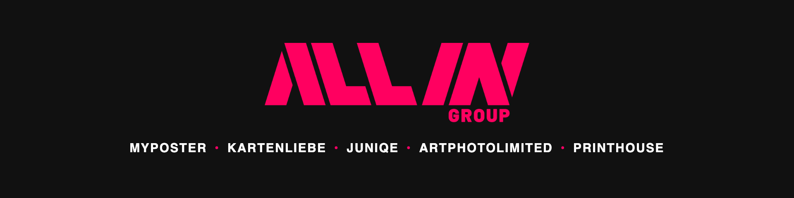

### We go ALL IN on what we love – to prove what's possible for people & businesses.

  

---

Founded in 2007 by René and Marc Ruhland, **bootstrapped ever since** – no outside capital.
We build our own software and run our own production, and today we're at **€100M+ annual revenue**.

## 🧩 Our brands

| Brand | What it is |
|---|---|
| [**MYPOSTER**](https://www.myposter.de) | Your photos on posters, canvas, photo books & more |
| [**Kartenliebe**](https://www.kartenliebe.de) | Cards for life's big moments |
| [**JUNIQE**](https://www.juniqe.com) | Affordable art & design prints |
| [**ArtPhotoLimited**](https://www.artphotolimited.com) | Limited-edition fine art photography |
| [**Printhouse**](https://www.printhouse.de) | Our own production – 16,500 m² of printing |
| **ALL IN Ventures** | Investing in what comes next |

## 💡 What we believe

- **Together** – no ego, no politics, just teamwork.
- **Never satisfied** – we challenge the status quo and go the extra mile.
- **Unstoppable** – energy and drive for strong results.
- **Nerdy** – passionate experts who dive deep.
- **Clear** – frank words, clear goals, full transparency.
- **Brave** – follow your heart, take bold risks.

## 📍 Where we are

München · Bergkirchen · Olching · Berlin · Bordeaux 🇫🇷

## 🚀 Join us

Want to go ALL IN? Check out our [open positions](https://www.all-in-group.com/jobs/) or drop us a line at [jobs@all-in-group.com](mailto:jobs@all-in-group.com).
